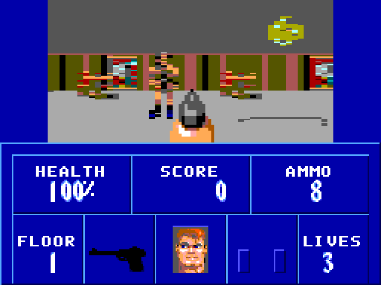
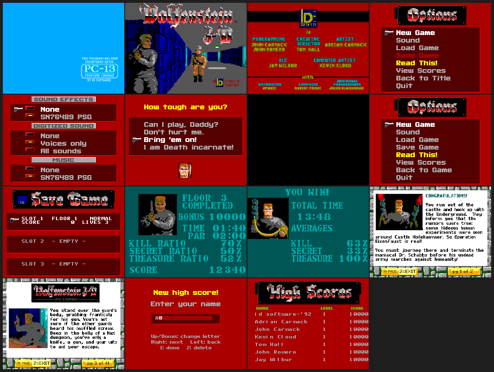

# Wolfenstein 3D for the Sega Master System

A port of id Software's *Wolfenstein 3D* (shareware v1.4, Episode 1, ten levels) to the Sega Master System:
a textured 192 x 96 view, every screen and menu of the original, high scores, three save slots, and all of the
sound and music.  The game logic is the original's (through the Genesis port `haroldo-ok/wolf-3d-md`,
translated by `tools/port_game.py`); the platform layer, the ray caster and the converters follow
`haroldo-ok/catacomb-abyss-sms`.

| area | state |
|---|---|
| 3-D view: textured walls, doors, push walls, sprites | done: **192 x 96** (24 x 12 tiles, 48 rays of 4 px), Wolfenstein's own 72 degree projection |
| all ten shareware levels, enemies, AI, weapons, pickups, HUD, weapon in hand | done, tested in the emulator |
| title (PG-13, title, credits, scores: the attract loop), main menu, new game (4 difficulties with BJ's faces), sound menu, quit | done: every screen is the original art, tile converted |
| Get Psyched, level completed (par time, kill / secret / treasure ratios and bonuses, BJ breathing), secret floor, victory, end text | done, with the original rules of WL_INTER.C |
| help ("Read This!", all 41 pages) and end texts | done: the original page layout engine (WL_TEXT.C) run offline, the keyboard pages rewritten for the SMS pad |
| high scores (7, name entry with the D-pad) | done, kept in cart RAM |
| 3 save slots | done: cart RAM page 1, mid-level, exact (see below) |
| sound effects (87), digitised voices (16), music (27 songs, 11 in the shareware) | done: SN76489 player in the frame interrupt, voices by the line interrupt |
| demo playback, the registered episodes | not included (the Genesis port omits them too) |

The ROM is **3.4 MB** (207 banks of 16 KB, standard Sega mapper, 32 KB cart RAM: page 0 the level, page 1 the
saves and scores).  It needs sprite magnification (the weapon) and battery RAM (saves, scores).  To play, build it
(next section) and open `wolf3d.sms` in an emulator that has those; only the test emulator `smstest` has been
tried (see *Not verified*).

## Building

You need Linux x86-64 (the only host tried), python3 with numpy and Pillow, curl, unzip, git and a C compiler.
The two scripts write only to the places listed in the table below.

    tools/setup_toolchain.sh    # once: SDCC 4.4.0 -> ~/sdcc440, makesms + peephole rules -> ~/.devkitsms
    tools/fetch_data.sh         # once: the shareware data and id's sources -> ../work (next to this directory)
    make                        # wolf3d.sms

The first `make` converts all of the id data into `gen/` (textures, sprites, the renderer's scalers and tables,
maps, HUD and weapon art, the screens, the audio): about 45 seconds.  The results are cached in `gen/cache/`, so
a rebuild after changing a converter takes about 30.  Then:

    make DEBUG=1    # wolf3d_dbg.sms: boots into the game, the test hooks (dbg_*); objects in build_dbg/
    make DET=1      # wolf3d_det.sms: the deterministic build of the equivalence tests (no sound); build_det/
    make NOGEN=1    # do not run the converters: use the gen/ that is there (it must have been made before)
    make clean      # the objects and the ROM of the chosen flavour; gen/ stays

The scripts and the Makefile look in these places, and each can be moved:

| what | default | override |
|---|---|---|
| SDCC 4.4.0 | `~/sdcc440/sdcc-4.4.0/bin` | `make SDCCBIN=...` |
| `makesms`, `peep-rules.txt` (devkitSMS) | `~/.devkitsms` | `make DK=...` |
| the shareware `*.WL1` files | `../work/data` (or `work/data`) | `WL_DATA=...` |
| id's source release (names, palette) | `../work/wolf3d` (or `work/wolf3d`) | `WL_SRC=...` |
| the Genesis port (only `tools/port_game.py`) | `../wolf-3d-md/src` | `WL_MD=...` |

**SDCC must be 4.4.0.**  4.5.0 miscompiles `if (a != g) { g = a; ... }`, and 4.4.0 needs `--reserve-regs-iy` (see
*Toolchain pitfalls*).  Do not use a distribution's `sdcc`.

## Controls

D-pad: up/down walk, left/right turn.  Button 1: fire.  Button 2: use (doors, push walls, the elevator); held
with left/right it strafes; pressed while holding down it changes weapon.  The console's **Pause** button opens
the menu during the game.  In menus: up/down moves the gun, button 1 selects, button 2 (or Pause) backs out.
Name entry: up/down change the letter, right/left move, button 2 deletes, button 1 (or Pause) is done.

A game frame takes 0.08 - 0.3 s, so the pad is sampled at every vblank and the game gets what happened since
its last poll: a button press is a fresh press even when it was over before the poll (taps on a touch overlay
work), and a direction moves the player for as long as it was held within the frame.

## How it works

### The front end

* **Screens** (`tools/wl_pics.py`): each is a 256 x 192 picture made of the original pictures and fonts (menus
  composed at the original layout with a 16 pixel item pitch; the 320 x 200 pictures and the help pages scaled by
  dropping the cheapest column of five and row of 25, which never blends colours), turned into 8 x 8 tiles and
  two 16 colour palettes (`scrcore.py`: exact SMS gamut, a palette chosen for every cell, similar tiles merged
  with the text protected).  A menu screen has at most 432 tiles (its cursor's 12 sprite tiles take 436 - 447), a
  picture screen 440 - 448.  A menu highlights an item by switching the palette bit of its cells (palette 1 =
  palette 0 but for the ink slots); the cursor is six hardware sprites; numbers on the intermission are 16 x 16
  digit glyphs written into the name table; names and scores use an 8 x 8 font cut from the original small font.
  Layout constants (`LAY_*`) are generated into `gen/assets.h`.
* **Flow** (`src/main.c`, `inter.c`, `menu.c`): PG-13, then title / credits / scores until a button; the control
  panel; `GameLoop` (the original's) with Get Psyched, level completed, died, victory, end text, high scores.
* **Help and end texts** (`tools/wl_text.py`): the page layout of WL_TEXT.C (fonts, pictures, line breaking,
  the `^` commands) is run at build time, so the ROM holds finished pages.

### Saves and scores (`src/save.c`)

* 3 slots of 5.3 KB.  The level is *rebuilt* on load (`SetupGameLevel`), then only what the player changed is
  applied: the game state, the push wall journal (`pwj` in `wl_act1.c`: the tiles they touched), the area
  overrides, the doors, the statics and the actors (zero run length coded, checksummed).  The largest save, a
  fresh E1M5, is 3.7 KB.
* `tests/t_save.txt` hashes the whole game state (actors, statics, doors, tile and actor maps) before a save,
  damages it, loads, and requires the same hash: on all ten levels and with a push wall moving.  (A walking
  actor's `tilex` is the tile it is heading for, not `x >> 16`: it is saved.)
* **Scores** live in cart RAM page 1 with a checksum.  `tests/t_scores.py` enters a name, quits from the menu (the
  program starts again: the player is back on the start tile) and requires the same table afterwards.
* After a load the code that keeps caches must reset them (`save.c` does): `STATICS_CHANGED()` (def.h:
  `CheckPickups`, the statics list of the renderer, the exit tile test), `doors_busy` (the number of doors that
  are not closed, recomputed from `doorobjlist`), `AreaCacheReset()`, and `render_invalidate()` after anything
  that overwrote the view's tiles.

### Sound (`src/snd.c`, `snd_ctl.c`, `tools/wl_audio.py`)

* **Effects**: the AdLib sounds (AUDIOT) -> PSG event streams: pitch = F-number x block x the carrier's
  multiplier, volume from the carrier's ADSR and level, and the 13 noisy ones (gunshots, hits, damage: jumpy
  frequency data) go to the noise channel.  An effect takes tone channel 2 and the noise channel from the music
  while it lasts.  9 KB for all 87.
* **Music**: the IMF songs are simulated (OPL2 register state, 9 channels with envelopes) every 1/70 s and the 3
  most important notes at any moment are given to the 3 PSG voices (no voice flicker, steal only when clearly
  better); 38 KB for all songs.  Streams are read from the frame interrupt (70 ticks a second from the 60 Hz
  clock); the interrupt maps the stream's bank and gives slot 2 back **as it found it** (the renderer maps slot 2
  itself, so `slot2_cur` cannot be trusted there).
* **Digitised voices**: the 16 VSWAP samples (7 kHz, 8 bit) -> 7.86 kHz, two PSG channels summed (the volume
  commands of channels 1 and 2 are the sample, error diffusion, 22 dB SNR): 133 K samples of 2 bytes, 265 KB in 17
  banks.  The line interrupt (every second line, 96 a frame during the picture) writes them from a RAM buffer that
  the frame interrupt fills, so it never touches the mapper.  It costs the game about 12% while a voice plays (a
  firefight).  The line interrupt does not run during vblank: a voice is chopped into 12 ms pieces and plays
  1.36 x as long, at the right pitch.
* Sound menu: sound effects off / on; digitised sound **None / Voices only (default: guards, screams, damage, the
  dog) / All sounds** (weapons and doors too, which repeat all the time and cost speed); music off / on.
* `tools/psg2wav.py` renders an smstest `psglog` to a WAV.

## Tests

    tests/run_all.sh        # builds the three ROMs and runs everything below (under two minutes): 18 checks

`tools/smstest` is a headless Z80 + VDP emulator (from the SMS skill; here with sprite magnification,
`waitchange` and `SMSTEST_FLATPAL` added).  `run_all.sh` builds it if it is missing (`make -C tools/smstest`).
`bash tools/st.sh wolf3d_dbg.sms script.txt` runs one script.

* `tests/t_*.txt`, smstest scripts that assert on game state or the screen: boot, walking through doors, a fight
  (warp + fire: the guard dies, 100 points), pickups (ammo, weapon), the damage flash fading, all ten levels
  loading, short taps and rapid fire, death and respawn, `t_front` (every screen of the release ROM is up when it
  should be, the in-game menu and back), `t_release` (the release ROM), `t_save` (DET build).
* `tests/t_audio.py`: the PSG writes of the title music, a voice (by the line interrupt) and an effect.
  `tests/t_scores.py`: a high score survives a reset.  `tests/check_view.py` compares the ROM's wall geometry
  with `tools/refview.py`, a float ray caster using the real textures and the original projection.
* `tests/det/det.py`, **the equivalence test of the optimised code**: eight scripted scenarios (idle, walking
  through doors, turning, a fight, being shot to death, a room full of sprites, the secret push wall, all ten
  levels) run on the deterministic build (`make DET=1`: a fixed 24 tic step per frame, a constant random seed, the
  pad as it is at the poll, a frame never shorter than two vblanks, and `dbg_hash` = a hash of the whole game
  state).  For every frame it compares the hash of the screen (smstest `hooklog` at the entry of
  `ThreeDRefresh`, with `SMSTEST_FLATPAL=1` so a palette write in the middle of a frame doesn't count) and, at
  the checkpoints, `dbg_hash` with `tests/det/golden.json`.  The golden file was recorded from the code *before*
  each optimisation (the C originals), so "PASS" means the faster code plays and draws exactly the same game.
  `python3 tests/det/det.py --update NAME` re-records scenarios (only after checking that a difference is
  intended); `--rom/--noi` run another build.
* `src/dbg.c` (DET build only) compares each hand written routine with the C code it replaced, over many inputs:
  `act_dec`, `mul_tics`, `LineStep`, the projection (`xf_tile`, `xf_obj`: 4800 tiles and positions on both sides
  of the view), `add_sprite` (random sequences, also past the full list) and `in_view` (every offset x 52
  bearings).  `run_all.sh` asserts that all the counters are zero.
* Benchmarks: `python3 tools/bench.py walk turn room` (scripts in `tests/bench/`, on `wolf3d_dbg.sms` in real
  time), `tools/prof_wolf.py` (call-graph profile of a bench run: self and inclusive cycles per function, bank
  aware; `--callers F`, `--tree F`, `--asm F`).  `python3 tools/docshots.py` makes the pictures in `docs/`.

## Technical notes

### The view and the memory map

* **View**: 192 x 96 = 24 x 12 tiles at column 4, 48 rays of 4 px; `KH` = 132 (the multiply in `sprites_a.s` is
  generated: `gen/khmul.inc`); wall height `158.4 / distance`.  The view is 96 px high, so near objects look
  larger against it than in the original (47 degree vertical field there, 34 here); a sprite is 5/6 as wide as
  it is high.  The constants come from `tools/render_gen.py` through `gen/assets.h` and `gen/assets.inc`.
* **Weapon**: 8x8 sprites with the VDP's magnify bit (R1 bit 0), 8 columns x 5 rows, only the non-empty blocks.
  Real hardware does this; an emulator core without sprite magnification shows it as separate small pieces.
* **Palette**: 16 colours shared by walls and sprites (the 16 of the 64 SMS colours with the least weighted Lab
  error over all wall textures and sprites; refitting to Episode 1's textures gained nothing).  The damage flash
  is capped at level 2 of 3 and the pickup flash at level 1 (a full level paints one colour).
* **VRAM**: view 288 tiles + 3 flat + HUD 112 + weapon <= 28 = 431 < 448 (`wl_hud.py` asserts).  `HUD_T0` = 291;
  the 112 HUD tiles are static 78, face 16, weapon icon 18, and the weapon sprites follow.
* **Banks**: slot 0 (0x0000 - 0x3FFF) is bank 0, always mapped: `main hw snd render mathz level plat0`, the asm
  and the generated tables.  It has **399 bytes free** in the release build (99 in debug, 582 in DET), so it is
  full: new code goes into the banked banks.  Those are switched into slot 1 (0x4000 - 0x7FFF): 1 - 4 the game
  (`wl_play/main/game` + the random table, `wl_agent`, `wl_state/act1`, `wl_act2`), 5 `vid hud input weapon
  inter`, 6 `scr menu` + the screen tables, 7 `save`, 8 `snd_ctl` + the sound tables.  Slot 2 (0x8000 - 0xBFFF)
  shows the cart RAM during play (the level) or, mapped by the code that needs it, a bank of the data
  (`gen/data.bin`, from bank 16).  RAM is at 0xC000.  `tools/checkrom.py` reads the linker map after every link
  and fails the build on a bank overflow.  The DET build has no sound (it would not fit and must not depend on
  timing).
* **Interrupts**: the frame interrupt is the 70 Hz sound ticks + the clock + the pad; the line interrupt is off
  except while a voice plays.  The renderer's 4-byte VDP writes are 27 cycles apart: a voice's interrupts only
  delay them.

### Speed

smstest, NTSC, game frames per second (192 x 96 view, sound on): walking through the first rooms and doors 10.8;
turning in place (every ray changes) 4.2; a room with enemies and statics, moving and turning 3.0.  (The 224 x 80
view before the front end: 12.3 / 4.5 / 3.5; 5.7 / 3.0 / 2.25 before the optimisation pass.)  What was done, by
the profile: the sprite pipeline (culling, projection, list insertion, the per column lists, the sprite rays) is
Z80 (`src/sprites_a.s`), statics near the camera are listed once per camera tile, the projection of a tile centre
needs only 4 bit multiplies, 32 bit multiplies and divisions in the actor code were replaced (`mul_tics`,
`LineStep`, `act_enc`), `CheckPickups`, `MoveDoors`, `AreaOf` and the exit tile test don't repeat work, the
palette flash is a table and is written only when it changes, and a moving view redraws only the columns whose
rays differ from the screen.

What is left is mostly the VRAM copy (`s2_rows`: 4 bytes per tile row, 27 cycles apart as the VDP requires): the
view's 288 tiles are 9,216 bytes, 249 k cycles, **4.2 console frames** whatever else is done.  When every column
is redrawn that is about 29% of a game frame (turning in place), and it caps a full redraw at about 14 frames a
second before a single ray is cast.

### Toolchain pitfalls

* SDCC 4.4.0 needs `--reserve-regs-iy`: the compiler reloads IY and then keeps using it as if it still pointed at
  the old object (`player->tilex` got garbage, which broke line of sight, shooting and AI distances).
* `src/mulfix.s` replaces the int x int -> long multiply of the runtime (`__mulsint2slong` tests the sign in the
  low bytes: wrong when the low byte is >= 0x80); `__mullong` costs over 3,000 cycles, so 32 bit products are
  avoided in hot code.
* Banked code cannot call helpers that live in the slot it replaces, and banked files cannot have initialised
  globals; the renderer's asm writes the mapper register directly, so an interrupt must save and restore the real
  mapper state, not `slot2_cur`.

### Generated files and hand edits

* `gen/` is generated by `make` (`tools/build_assets.py`) from the id data, with two exceptions that ship with the
  sources: `gen/states.c` and `gen/states.h` (the actor state tables) are made by `tools/port_game.py`, not by the
  build.
* `src/game/*.c` are the working sources of the game logic.  `tools/port_game.py` (+ `patch_game.py`) made them
  from the Genesis port once, mechanically; since then they have been edited by hand (the push wall journal in
  `wl_act1.c`, `AreaCacheReset`, the saved-game hooks, the pad handling...), and `wl_game.c` and `wl_main.c` were
  written by hand.  `port_game.py` is kept as a record and refuses to overwrite files unless given `-f`.  Don't
  pass it.  `tools/fetch_data.sh --genesis` fetches the Genesis port for anyone who wants to read it next to the
  translation.

## Repository layout

| path | what |
|---|---|
| `Makefile` | the banked build: three flavours, `NOGEN=1` |
| `src/` | the platform layer and the engine, in C and Z80 asm (`crt0.s`, `header.s`: boot and ROM header; `cartram.h`, `cartsyms.s`: the cart RAM map) |
| `src/hw.c` `render.c` `render_a.s` `sprites_a.s` `fast.s` `mulfix.s` `mathz.c` `level.c` `plat0.c` | bank 0: hardware and interrupts, the ray caster and the sprite pipeline, hand-written Z80 helpers, maths, the level's ROM data, timer |
| `src/vid.c` `hud.c` `weapon.c` `input.c` | video modes and fades, the status bar, the weapon sprites, the pad |
| `src/scr.c` `menu.c` `inter.c` `save.c` `ui.h` | the front end: screen loader, menus and help pages, intermission / scores / title, save games |
| `src/snd.c` `snd_ctl.c` `snd.h` | the sound player: interrupt side (bank 0), control (banked) |
| `src/dbg.c` | the DET build's state hash and self checks |
| `src/game/` | the game logic: `wl_play wl_agent wl_state wl_act1 wl_act2 wl_game wl_main`, `def.h` |
| `gen/` | `states.c`, `states.h`; everything else is made by `make` |
| `tools/build_assets.py` | runs the converters below, packs `gen/data.bin` into banks |
| `tools/wolfdata.py` `wl_names.py` `sprnames.py` `paths.py` | read the id data and sources; where to find them |
| `tools/wl_assets.py` `render_gen.py` `wl_view.py` `wl_gfx.py` `wl_maps.py` `wl_hud.py` | textures, sprites, scalers and tables, view palette, graphics, maps, HUD and weapon art |
| `tools/scrcore.py` `wl_scr.py` `wl_pics.py` `wl_text.py` | the screens: quantiser and tile merging, screen format, every screen, the page layout engine |
| `tools/wl_audio.py` `psg2wav.py` | effects, music and voices; a WAV from a PSG log |
| `tools/port_game.py` `patch_game.py` `gen_states.py` | the one-off translation of the Genesis sources (see above) |
| `tools/sms.py` `packer.py` `checkrom.py` | SMS colour and tile formats, bank packing, the post-link check of the map (bank overflows) |
| `tools/smstest/` | the headless emulator (C; `make -C tools/smstest`); `st.sh` runs it |
| `tools/setup_toolchain.sh` `fetch_data.sh` `make_zip.sh` | install the toolchain, download the id data, make the sources zip |
| `tools/bench.py` `prof_wolf.py` `refview.py` `docshots.py` | benchmarks, profiler, the float reference renderer, the screenshots of `docs/` |
| `tests/` | `run_all.sh`, the smstest scripts, `t_audio.py`, `t_scores.py`, `check_view.py`, `det/` (equivalence), `bench/` |
| `docs/` | screenshots |

## Credits and licence

* *Wolfenstein 3D* is © 1992 id Software.  The art, music, sounds and maps this port converts are from the
  shareware v1.4 release (Episode 1); the game logic is a translation of id's source.
* id's source release (github.com/id-Software/wolf3d) comes with a *Limited Use Software License Agreement*
  (`WOLFSRC/README/LICENSE.DOC`): in short, educational use of portions of the source, no commercial use, no
  distributing the Software for money or other consideration, no copies beyond a backup.  The Genesis port's
  README calls that source GPL; the licence file in id's repository is the limited-use one, and this project has
  not tried to settle the difference.  Treat `src/game/` (a translation of that code), `gen/` and the ROM (which
  contain id's data, converted) as id's: for personal and educational use.  That is why the sources zip holds no
  converted data: `tools/fetch_data.sh` downloads the original shareware archive and `make` converts it.
* The code that is new in this port (renderer, platform layer, converters, front end, sound, saves, tests) has
  no licence file yet.  Choose one before publishing; it cannot widen what id's terms allow for the parts above.
* `haroldo-ok/wolf-3d-md` (the Genesis port: game logic as C, the asset pipeline this port started from),
  `haroldo-ok/catacomb-abyss-sms` (the SMS platform layer and ray caster this one follows), `sverx/devkitSMS`
  (`crt0`, `makesms`), SDCC 4.4.0.
* `tools/smstest/`: the headless emulator from `haroldo-ok/sega-master-system-skill-for-claude` (MIT; its Z80
  core is Nicolas Allemand's, also MIT; both licences are in the directory), with sprite magnification,
  `waitchange` and `SMSTEST_FLATPAL` added here.

## Not verified

Real hardware, PAL consoles (the 70 Hz clock and the music tempo assume 60 frames a second) and emulator cores
other than `smstest` (RetroArch cores, Emulicious, ...) have not been tried.  The speeds above are cycle counts
of `smstest` (NTSC: 59736 cycles per console frame), not measurements on a console.  In particular the sampled
voices depend on the line interrupt and on the SN76489 playing a constant tone at period 1 as a steady level, and
the weapon needs the VDP's magnify bit.  The sound has been checked as register writes (and rendered to WAV),
not by ear.  The build has been run on Linux x86-64 with Python 3.13, numpy 2.3 and Pillow 12 only.
